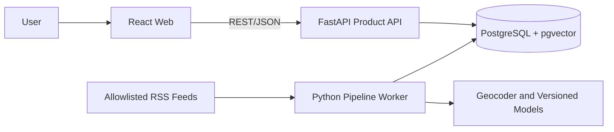

# Geo News

Geo News is a Vietnam-first news aggregator that groups duplicate coverage into location-aware events while preserving every contributing source.

> **Status:** Phase 1 scaffold in place (health/version API, worker skeleton, React shell, Compose, CI). No product features yet. Work is [split across the three team members](split/README.md).

## Overview

Readers face information overload: many outlets publish near-identical reports of one incident, and country filters reflect where a publisher is based, not where the event happened. Geo News ingests allowlisted RSS feeds, detects duplicates, extracts the location each story is about, and clusters related articles into a single event.

Each event shows a coverage timeline, a location (or an explicit *unknown* rather than a wrong pin) and links to every contributing article. Clustering combines semantic similarity with entities, location and time, and records every score so decisions can be explained and corrected.

Research question: *How can a news system reduce information overload by grouping duplicate coverage into location-aware events while preserving source provenance?*

## Scope

| Priority | What | Status |
| :--- | :--- | :--- |
| **P0** | Allowlisted RSS ingestion, normalization, provenance-preserving duplicate detection, primary-location extraction with an unknown state, explainable clustering, public event feed and detail page, timeline, filters, reproducible evaluation | Committed |
| **P1** | Review queue and audited corrections (location, move, merge, split), starting after P0 is stable | Committed (one full correction path minimum) |
| **P2** | Accounts and bookmarks, map view, grounded AI summaries, wider Southeast Asian coverage | Deferred; starts only after all P0/P1 gates pass |

Delivery is 12 weeks for a team of three. Details: [PRD](docs/PRD.md).

## Technology Stack

Working baseline from the [TRD](docs/TRD.md#2-technology-decisions). Model and geocoder choices stay provisional until validated on Vietnamese and English data.

| Area | Decision |
| :--- | :--- |
| Web client | React + TypeScript + Vite |
| Product API | Python 3.12, FastAPI, Pydantic |
| Persistence | SQLAlchemy 2, Alembic |
| Pipeline | Python worker with APScheduler (no message broker) |
| Database | PostgreSQL 16 with pgvector |
| NLP | Version-pinned multilingual NER and sentence-transformer models |
| Geocoding | Cached, replaceable Nominatim-compatible adapter |
| Map / summary | Leaflet + OpenStreetMap; configurable external model (both P2) |
| Runtime and quality | Docker Compose; pytest, Ruff, Vitest, Playwright, GitHub Actions |

## Architecture



The web app never touches the database, feeds or models; the API serves queries and corrections; the worker does ingestion, enrichment and clustering. See [TRD §3](docs/TRD.md#3-system-context).

## Repository Structure

```text
geo-news/
├── apps/api/           # FastAPI app (health, version, error envelope)
├── apps/web/           # React + TypeScript + Vite shell
├── workers/pipeline/   # APScheduler worker, stage/status enums
├── packages/geo_news/  # shared Python config
├── db/                 # migrations/ and seeds/ (empty until P1-04)
├── tests/fixtures/     # deterministic fixtures
├── docs/               # PRD, TRD, SPEC, Implementation Plan, adr/
├── split/              # work split
├── compose.yaml, .env.example, pyproject.toml, .github/workflows/ci.yml
└── Backend/ Database/ Frontend/ ExternalServices/   # legacy placeholders, safe to delete
```

## Prerequisites

Git, Python 3.12+, Node.js 20+ (LTS), Docker with Compose. PostgreSQL 16 with pgvector runs in Docker. Versions are targets; confirm when code is added.

## Installation

```bash
cp .env.example .env            # set POSTGRES_PASSWORD and APP_SECRET_KEY
python -m venv .venv && . .venv/bin/activate   # Windows: .venv\Scripts\activate
pip install ./packages/geo_news ./apps/api ./workers/pipeline
cd apps/web && npm install
```

## Environment Configuration

Planned variables from [TRD §11.3](docs/TRD.md#113-configuration-baseline). Never commit real values.

```env
DATABASE_URL=
API_BASE_URL=
APP_SECRET_KEY=
GEOCODER_BASE_URL=
GEOCODER_USER_AGENT=
MODEL_CACHE_DIR=
SUMMARY_API_KEY=        # optional, P2 only
```

Feed sources are validated database records, not environment variables.

## Running and Testing

```bash
docker compose up --build      # db :5432, api :8000, worker, web :5173
ruff check . && pytest         # Python lint and tests
cd apps/web && npm run build   # type-check and build the web app
```

Check the API at `http://localhost:8000/api/v1/health/live`. The test approach and CI gates are in [SPEC §7–9](docs/SPEC.md#7-verification-matrix).

## Roadmap

Five gated phases over 12 weeks ([Implementation Plan](docs/IMPLEMENTATION_PLAN.md#7-phase-plan)):

| Weeks | Phase | Gate |
| :--- | :--- | :--- |
| 1–2 | Foundation and walking skeleton | G1: one fixture event visible in the browser |
| 3–4 | Reliable ingestion and provenance | G2: idempotent, safe, inspectable |
| 5–6 | Intelligence and evaluation baseline | G3: explainable events, reproducible report |
| 7–8 | Reader MVP | G4: feed, detail, provenance, filters pass E2E |
| 9–12 | Review, hardening and release | G5 (Week 10): correction path and scope freeze; G6 (Week 12): tagged release |

## Team

Roles come from the [Implementation Plan](docs/IMPLEMENTATION_PLAN.md#4-recommended-roles-for-three-people). Bao, Phat and Huy take Person A, B and C respectively.

| Member | Role | Focus |
| :--- | :--- | :--- |
| Bao | Platform and API Lead | FastAPI, schema and migrations, projections, corrections and audit, deployment |
| Phat | Data Intelligence and Evaluation Lead | Ingestion, duplicates, location, embeddings, clustering, evaluation |
| Huy | Product Experience and Quality Lead | React app, accessibility, CI and Compose, end-to-end tests, release |

Task lists: [work split](split/README.md).

## Documentation

| Document | Purpose |
| :--- | :--- |
| [PRD](docs/PRD.md) | Product goals, success measures, scope (P0/P1/P2), user journeys, risks |
| [TRD](docs/TRD.md) | Architecture, technology decisions, data model, pipeline, API baseline, security, deployment |
| [SPEC](docs/SPEC.md) | Canonical requirements, acceptance criteria, evaluation specification, verification matrix |
| [Implementation Plan](docs/IMPLEMENTATION_PLAN.md) | Roles, phases, work packages, gates, risks, release checklist |
| [Work split](split/README.md) | Assignment of the plan's work packages to the three members |

The PRD sets intent and priority, the TRD the technical solution, and the SPEC what counts as done; the Implementation Plan covers delivery.
