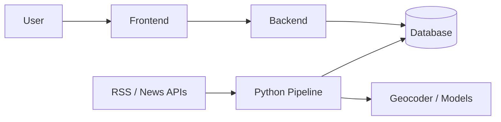

# Geo News

A Southeast Asia-focused news aggregator that groups duplicate coverage into location-aware **events**, with timelines, maps and full source provenance.

> **Status:** Planning stage. The repository contains documentation only. Sections below marked `TBD` depend on technology decisions not yet made.

## Project Overview

News readers face information overload: many outlets publish near-identical reports of one incident, and country filters reflect where a publisher is based, not where the event happened. Geo News ingests RSS/news feeds for Vietnam / Southeast Asia, removes duplicates, extracts the location each story is about, and clusters related articles into a single event.

Each event shows a coverage timeline, a location (or an explicit "unknown" rather than a wrong pin) and links to every contributing article. Clustering combines semantic similarity with entities, location and time to avoid merging distinct events such as two protests in one city.

Research question: *How can a news system reduce information overload by grouping duplicate coverage into location-aware events while preserving source provenance?*

## Main Features

- Event feed (clustered events instead of raw articles)
- Event page with coverage timeline and source articles
- Source provenance list
- Search and filters (topic, location, time)
- Accounts and bookmarks
- Map view *(secondary)*
- Grounded AI summary built only from the event's own articles *(secondary)*

## Technology Stack

Decisions and rationale: [architecture](docs/04-system-architecture.md#technology-decisions). Model and geocoder choices are provisional until validated on Vietnamese data.

| Area | Planned |
| :--- | :--- |
| Frontend | React + TypeScript (Vite); Leaflet + OpenStreetMap |
| Backend | Python 3.12, FastAPI, SQLAlchemy, Alembic |
| Data pipeline | Python: Hugging Face NER, `sentence-transformers`, clustering, APScheduler |
| Database | PostgreSQL 16 with pgvector |
| Infrastructure | Docker Compose; hosting provider `TBD` |
| DevOps | GitHub Actions (planned; not yet configured) |
| Testing | pytest, Vitest, Playwright; clustering evaluated by precision/recall on labeled data |
| External services | Nominatim (geocoding), Claude API (optional summaries) |

## Project Architecture



## Project Structure

```text
geo-news/
├── docs/               # project documentation (see below)
├── Backend/            # product API (empty for now)
├── Database/           # schema and migrations (empty for now)
├── Frontend/           # web client (empty for now)
└── ExternalServices/   # geocoder / model adapters (empty for now)
```

The four directories hold only a `.gitkeep`; the proposed full layout (including the Python pipeline) is in [technical design](docs/05-technical-design.md#1-source-layout-proposed).

## Prerequisites

Git, Python 3.12+, Node.js 20+ (LTS), Docker with Compose, PostgreSQL 16 with pgvector (via Docker). Versions are targets; confirm when code is added.

## Installation

`TBD` – no installable code exists yet. This section will be completed with the first implementation.

## Environment Configuration

Planned variables (proposals; never commit real values):

```env
DATABASE_URL=
SECRET_KEY=
API_BASE_URL=
GEOCODER_USER_AGENT=
ANTHROPIC_API_KEY=
```

Full list in the [deployment guide](docs/08-deployment-guide.md#3-configuration).

## Running the Project

`TBD` – no run commands yet.

## Testing

`TBD` – see the [testing strategy](docs/07-testing-strategy.md).

## Roadmap

1. Ingestion and infrastructure
2. NLP and geocoding
3. Semantic clustering and evaluation
4. UI, timelines, map, grounded summaries

## Team

| Member | Domain |
| :--- | :--- |
| Member 1 | Backend core (API, auth, bookmarks, data models) |
| Member 2 | AI and data pipeline |
| Member 3 | Frontend (UI/UX, map, timeline, search) |

## Documentation

| Doc | Description |
| :--- | :--- |
| [01 Project Overview](docs/01-project-overview.md) | Background, problem, scope, status |
| [02 PRD](docs/02-prd.md) | Goals, features, success criteria, timeline |
| [03 SRS](docs/03-srs.md) | Functional and non-functional requirements |
| [04 System Architecture](docs/04-system-architecture.md) | Components, data flow, decisions |
| [05 Technical Design](docs/05-technical-design.md) | Pipeline, clustering algorithm |
| [06 Database & API Design](docs/06-database-api-design.md) | Proposed schema and endpoints |
| [07 Testing Strategy](docs/07-testing-strategy.md) | Tests and evaluation |
| [08 Deployment Guide](docs/08-deployment-guide.md) | Environments and configuration |

`docs/v2.docx` is the original feasibility study.
