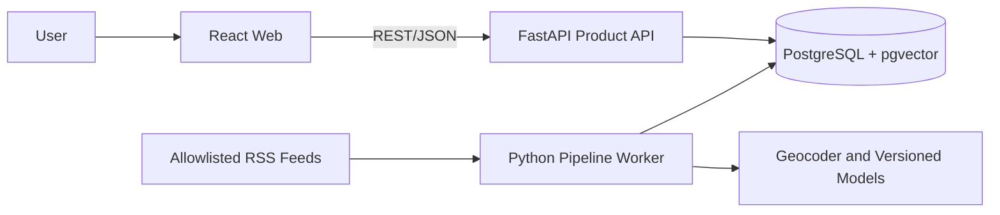

# Geo News

Geo News is a Vietnam-first news aggregator that groups duplicate coverage into location-aware events while preserving every contributing source.

> **Status:** Documentation and implementation-planning stage. No application code, containers, migrations, CI, or tests exist yet.

## Why Geo News?

Traditional feeds often show many near-identical articles about one incident and classify geography by publisher rather than event location. Geo News instead presents one event with:

- A coverage timeline.
- A resolved, unknown, or ambiguous event location.
- Direct links to all contributing articles.
- Explainable clustering based on semantic, entity, location, and time signals.

The core research question is: *How can a news system reduce information overload by grouping duplicate coverage into location-aware events while preserving source provenance?*

## MVP Scope

The core release includes allowlisted RSS ingestion, normalization, provenance-preserving duplicate detection, location extraction, explainable event clustering, a public event feed/detail experience, filters, and a reproducible evaluation.

Reviewer corrections follow after the core workflow is stable. Accounts, bookmarks, map visualization, AI summaries, and multi-country coverage are deferred.

## Planned Architecture



| Area | Working decision |
| :--- | :--- |
| Web | React + TypeScript + Vite |
| API | Python 3.12 + FastAPI + Pydantic |
| Pipeline | Python + APScheduler + versioned NLP/embedding models |
| Database | PostgreSQL 16 + pgvector |
| Persistence | SQLAlchemy 2 + Alembic |
| Local runtime | Docker Compose |
| Testing | pytest, Vitest, Playwright, labelled clustering/location evaluation |

Technology rationale and constraints are maintained in the TRD rather than duplicated here.

## Documentation

The project uses three authoritative documents:

| Document | Purpose |
| :--- | :--- |
| [Product Requirements Document](docs/PRD.md) | Why the product exists, users, scope, priorities, outcomes, and success measures |
| [Technical Requirements Document](docs/TRD.md) | Architecture, technology, data model, processing, security, reliability, and deployment |
| [Implementation Specification](docs/SPEC.md) | Canonical requirement IDs, acceptance criteria, behavior, verification, and work rules |

Information flows from the PRD and TRD into the SPEC:

```text
PRD: product intent ─┐
                    ├─> SPEC: implementable and verifiable requirements
TRD: technical plan ┘
```

Each decision has one authoritative home: product scope in the PRD, technical choices in the TRD, and requirement/test traceability in the SPEC.

## Repository State

The repository currently contains planning documents and empty implementation placeholders. The proposed implementation layout is documented in [TRD §4](docs/TRD.md#4-proposed-repository-layout).

Installation, runtime configuration, and test commands will be added when the first vertical slice is scaffolded. Until then, this README intentionally does not present placeholder commands as working instructions.

## Delivery Sequence

1. Freeze feeds, topics, languages, content-retention policy, and contracts.
2. Build a fixture-driven ingestion-to-database slice.
3. Add enrichment, location handling, clustering, and baseline evaluation.
4. Deliver the event feed, detail page, provenance, and filters.
5. Add review/correction, hardening, deployment, and final evaluation.

No deferred feature may displace an unmet core requirement.
