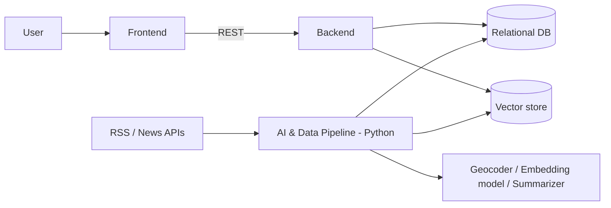
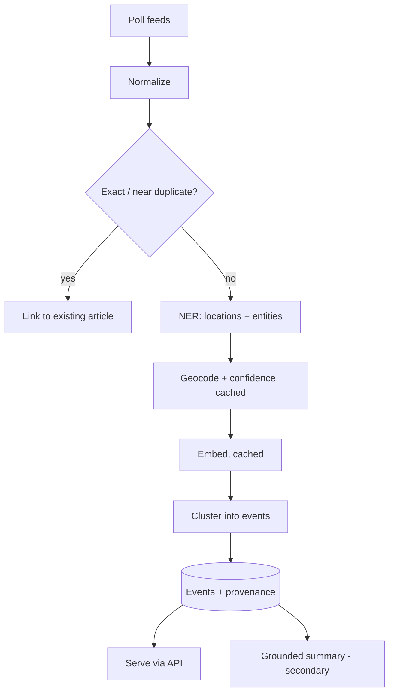

# 04 – System Architecture

> Planned architecture. Nothing is implemented. Stack choices are in [Technology Decisions](#technology-decisions).

## 1. Context and Goals

Turn a stream of RSS/news articles into de-duplicated, location-aware events and serve them to a web client while preserving source provenance. Separate **batch/streaming AI processing** (Python) from the **product API** (auth, bookmarks, queries).

## 2. High-Level Architecture

| Component | Planned stack | Responsibility |
| :--- | :--- | :--- |
| Frontend | React + TypeScript; Leaflet + OpenStreetMap | Feed, event page, timeline, map, search/filters |
| Backend core | Python + FastAPI | Product API, authentication, bookmarks, event queries |
| AI & data pipeline | Python | Ingestion, normalization, dedup, NER, geocoding, embeddings, clustering, evaluation, summaries |
| Relational DB | PostgreSQL | Articles, sources, events, users, bookmarks |
| Vector store | pgvector (in PostgreSQL) | Article embeddings |
| External services | Nominatim geocoder, local sentence-transformer model, Claude API for summaries | Place validation, embeddings, grounded summaries |

## 3. Data Flow

Step detail is in [05-technical-design.md](05-technical-design.md).

## 4. Integration Points

| Integration | Direction | Notes |
| :--- | :--- | :--- |
| Pipeline ↔ DB | write | Writes articles, events, embeddings. Backend reads. Shared PostgreSQL database |
| Backend ↔ Frontend | REST/JSON | See [06](06-database-api-design.md) |
| Pipeline → Nominatim | HTTP | Cached; max 1 req/s |
| Pipeline → Embedding model | local library | `sentence-transformers` |
| Pipeline → Claude API | HTTP | Grounded summaries only (secondary) |

## 5. Security Architecture (planned)

- Authentication for bookmarks: JWT bearer tokens; argon2/bcrypt password hashing.
- Secrets via environment variables, never committed.
- Summaries only draw on retrieved cluster text to limit hallucination.
- Input validation on all API inputs; CORS restricted to the frontend origin.

## 6. Key Decisions and Trade-offs

| Decision | Rationale | Trade-off |
| :--- | :--- | :--- |
| Event-centric model rather than article-centric | Directly addresses overload | Cluster errors become user-visible |
| Multi-signal similarity, not embeddings alone | Prevents merging distinct same-city events | More weights to tune |
| Fingerprint prefilter before embeddings | Cheaper | Misses paraphrased duplicates (handled by semantic step) |
| Location "unknown" state | Avoids wrong pins | Fewer events on the map |
| Map and summary deferred | Scope control | Late-phase risk |
| Python for AI, separate backend | Right tool per job | Two codebases to integrate |

## Technology Decisions

Decided as the working stack. Rationale reflects team skills (Java + Python, 3 members, one semester) and the "AI assists a deterministic system" principle. Items marked *verify* must be validated in a spike before being locked in.

| # | Area | Decision | Rationale | Alternative rejected |
| :--- | :--- | :--- | :--- | :--- |
| 1 | Backend | **Python 3.12 + FastAPI**, SQLAlchemy 2, Alembic, Pydantic | One language with the pipeline: shared models, DB code and tests; auto-generated OpenAPI. The backend is auth + CRUD + queries, so Java's strengths matter less | Java/Spring: heavier, splits the codebase in two |
| 2 | Frontend | **React + TypeScript (Vite)**, `react-leaflet` | Largest ecosystem and map integrations | Vue |
| 3 | Map | **Leaflet + OpenStreetMap tiles** | Free, no API token or billing | Mapbox: token and usage limits |
| 4 | Relational DB | **PostgreSQL 16** | Strong constraints/indexing, JSON, full-text search | MySQL, SQLite |
| 5 | Vector store | **pgvector** extension in the same PostgreSQL | One datastore; data volume (5–15 feeds) is small | Qdrant/Chroma: extra service to run |
| 6a | Geocoder | **Nominatim (OpenStreetMap)**, results cached in DB, max 1 req/s | Free; fits caching strategy. *Verify* coverage of Vietnamese place names | Google Geocoding: paid |
| 6b | NER | **Multilingual transformer NER** via Hugging Face `transformers` (e.g. an XLM-RoBERTa NER model); Vietnamese-specific tooling (e.g. `underthesea`) as fallback. *Verify* accuracy on Vietnamese news | Handles several SE Asian languages | spaCy default models (weak on Vietnamese) |
| 6c | Embeddings | **`sentence-transformers`** multilingual model (e.g. `paraphrase-multilingual-MiniLM-L12-v2`), run locally. *Verify* on labeled set | No API cost; cached | Hosted embedding API |
| 6d | Summarization | **Claude API (`claude-haiku-4-5-20251001`)**, prompted with cluster text only | Low cost, strong grounding behaviour; feature is optional | Local LLM: hardware burden |
| 7 | Scheduler | **APScheduler** inside the pipeline worker | No extra broker; enough for polling and re-merge jobs | Celery + Redis: overkill |
| 8 | Hosting | **Docker Compose** (local and single VM). Provider: **not decided here** (needs budget/account choice) | Reproducible, one command to run | Kubernetes: overkill |
| 9 | Auth | **JWT bearer tokens**, password hashing with argon2 (or bcrypt) | Stateless API for the React client | Server sessions |
| 10 | Tooling | `pytest`, `ruff`, Vitest, Playwright, GitHub Actions | Standard per language | |

### Consequences

- Java is not used. The team's Java experience is not exercised; Member 1 should plan time to learn FastAPI.
- The pipeline and backend share a Python package and one PostgreSQL database; keep module boundaries clear so they can be split later.
- pgvector limits scale to a single database. This is acceptable for the scoped dataset.
- Model and geocoder choices are provisional until the Phase 2 spike confirms Vietnamese quality (see [07](07-testing-strategy.md)).

## Remaining Open Items

| Item | Status |
| :--- | :--- |
| Hosting provider and budget | `TBD – Requires project/team decision` |
| Final region (Vietnam only vs. 4–5 countries) and language set | `TBD` |
| Feed list and topic list | `TBD` |
| Feed licensing / terms of use | `TBD` |
