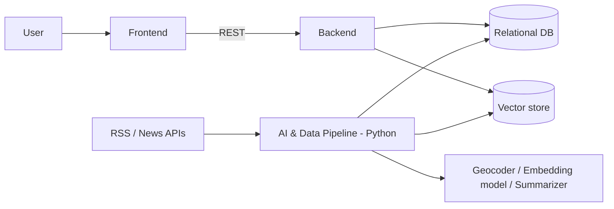
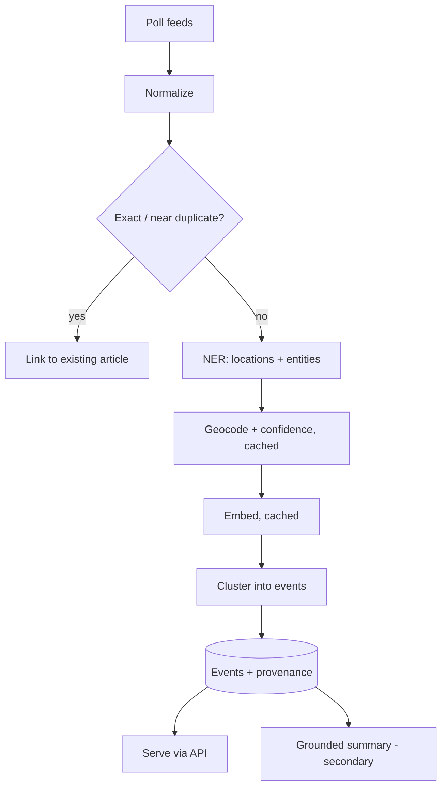

# 04 – System Architecture

> Planned architecture. Nothing is implemented. Alternatives still open are listed under [Open Decisions](#open-decisions).

## 1. Context and Goals

Turn a stream of RSS/news articles into de-duplicated, location-aware events and serve them to a web client while preserving source provenance. Separate **batch/streaming AI processing** (Python) from the **product API** (auth, bookmarks, queries).

## 2. High-Level Architecture

| Component | Planned stack | Responsibility |
| :--- | :--- | :--- |
| Frontend | React **or** Vue; Leaflet **or** Mapbox | Feed, event page, timeline, map, search/filters |
| Backend core | Java **or** FastAPI | Product API, authentication, bookmarks, event queries |
| AI & data pipeline | Python | Ingestion, normalization, dedup, NER, geocoding, embeddings, clustering, evaluation, summaries |
| Relational DB | `TBD` engine | Articles, sources, events, users, bookmarks |
| Vector store | `TBD` (separate store or DB extension) | Article embeddings |
| External services | Geocoding API, sentence-transformer model, summarization model (all `TBD`) | Place validation, embeddings, grounded summaries |

## 3. Data Flow

Step detail is in [05-technical-design.md](05-technical-design.md).

## 4. Integration Points

| Integration | Direction | Notes |
| :--- | :--- | :--- |
| Pipeline ↔ DB | write | Writes articles, events, embeddings. Backend reads. Shared-DB vs. internal API: `TBD` |
| Backend ↔ Frontend | REST/JSON | See [06](06-database-api-design.md) |
| Pipeline → Geocoder | HTTP | Cached; rate limited |
| Pipeline → Embedding / summarization model | local or API | `TBD` |

## 5. Security Architecture (planned)

- Authentication and authorization for bookmarks: mechanism (session vs. token) `TBD`.
- Secrets via environment variables, never committed.
- Summaries only draw on retrieved cluster text to limit hallucination.
- Input validation on all API inputs; CORS policy `TBD`.

## 6. Key Decisions and Trade-offs

| Decision | Rationale | Trade-off |
| :--- | :--- | :--- |
| Event-centric model rather than article-centric | Directly addresses overload | Cluster errors become user-visible |
| Multi-signal similarity, not embeddings alone | Prevents merging distinct same-city events | More weights to tune |
| Fingerprint prefilter before embeddings | Cheaper | Misses paraphrased duplicates (handled by semantic step) |
| Location "unknown" state | Avoids wrong pins | Fewer events on the map |
| Map and summary deferred | Scope control | Late-phase risk |
| Python for AI, separate backend | Right tool per job | Two codebases to integrate |

## Open Decisions

| # | Decision | Options | Owner |
| :--- | :--- | :--- | :--- |
| 1 | Backend language | Java or FastAPI | `TBD` |
| 2 | Frontend framework | React or Vue | `TBD` |
| 3 | Map library | Leaflet or Mapbox | `TBD` |
| 4 | Relational DB | `TBD` | `TBD` |
| 5 | Vector store | `TBD` | `TBD` |
| 6 | Geocoder, NER, embedding and summarization models | `TBD` | `TBD` |
| 7 | Scheduler for polling and re-merge jobs | `TBD` | `TBD` |
| 8 | Hosting | `TBD` | `TBD` |
