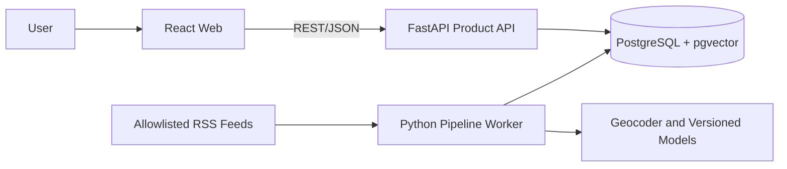
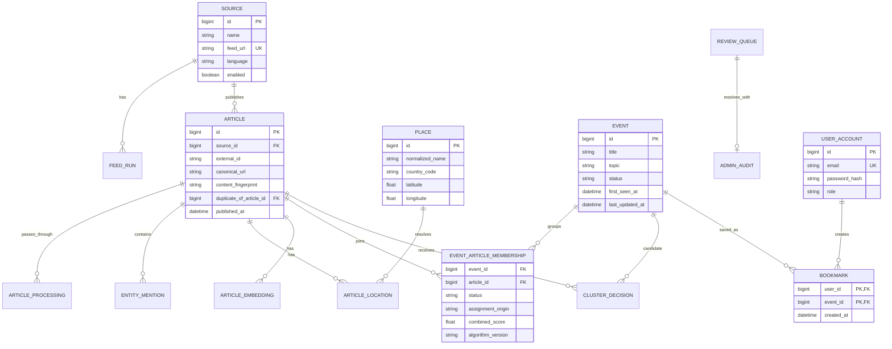

# Geo News — Technical Requirements Document

| Field | Value |
| :--- | :--- |
| Status | Draft implementation baseline |
| Version | 0.2 |
| Last updated | 2026-10-07 |
| Product source | [PRD.md](PRD.md) |
| Verification source | [SPEC.md](SPEC.md) |

## 1. Architecture Principles

1. Keep the system small: three applications and one authoritative database.
2. Build a thin end-to-end slice before deepening any subsystem.
3. Make ML-assisted decisions explainable, versioned, measurable, and correctable.
4. Preserve raw provenance and previously published data when processing fails.
5. Treat unknown or ambiguous data as valid states.
6. Use scheduled processing without a message broker in the MVP.
7. Keep the core product usable without accounts, mapping, or summarization.
8. Prefer deterministic fixtures and replaceable external-service adapters.

## 2. Technology Decisions

These decisions are the working baseline. Model and geocoder choices remain subject to the evaluation spike.

| Area | Decision | Rationale |
| :--- | :--- | :--- |
| Web client | React + TypeScript + Vite | Mature ecosystem and straightforward responsive UI |
| Product API | Python 3.12 + FastAPI + Pydantic | One server-side language shared with the pipeline and generated OpenAPI support |
| Persistence | SQLAlchemy 2 + Alembic | Explicit models and ordered schema migrations |
| Pipeline | Python worker + APScheduler | Scheduled workload without a broker |
| Database | PostgreSQL 16 + pgvector | Relational integrity, full-text capability, and vectors in one datastore |
| Geocoding | Cached Nominatim-compatible adapter | Replaceable provider with fixture support |
| NLP | Version-pinned multilingual NER and sentence-transformer models | Local, reproducible inference subject to Vietnamese evaluation |
| Map | Leaflet + OpenStreetMap, P2 only | No required commercial token |
| Summary | Configurable external model, P2 only | Optional and isolated from the core workflow |
| Local runtime | Docker Compose | Reproducible multi-component environment |
| Quality | pytest, Ruff, Vitest, Playwright, GitHub Actions | Automated checks across the stack |

The model identifier, thresholds, weights, and external endpoints are configuration, not hard-coded domain rules. Significant changes require a short architecture decision record under `docs/adr/`.

## 3. System Context



| Component | Responsibility | Explicitly does not do |
| :--- | :--- | :--- |
| React web | Reader and reviewer interfaces; API client | Direct database, feed, model, or geocoder access |
| FastAPI product API | Public queries, validation, corrections, audit transactions, later identity/bookmarks | Feed polling, model inference, or clustering |
| Python pipeline worker | Ingestion, normalization, enrichment, clustering, reconciliation, evaluation | Public browser API or authorization decisions |
| PostgreSQL | Authoritative application data, pipeline state, audit history, and embeddings | Background scheduling or external API calls |

The API and pipeline may share a Python domain package, but their deployable boundaries and table-writing responsibilities remain explicit.

## 4. Proposed Repository Layout

```text
geo-news/
├── apps/
│   ├── api/                 # FastAPI application
│   └── web/                 # React application
├── workers/
│   └── pipeline/            # ingestion, NLP, clustering, evaluation
├── packages/
│   └── geo_news/            # shared Python domain/configuration code
├── db/
│   ├── migrations/
│   └── seeds/
├── tests/
│   └── fixtures/
├── docs/
│   ├── PRD.md
│   ├── TRD.md
│   ├── SPEC.md
│   └── adr/
├── openapi.yaml             # added when the API contract is frozen
└── compose.yaml
```

The current empty top-level placeholders may be replaced when the first vertical slice is scaffolded.

## 5. Logical Data Model



The diagram is logical rather than field-complete. Migrations are authoritative once implementation begins.

### 5.1 Required entities

| Entity | Purpose |
| :--- | :--- |
| `source` | Feed identity, allowlist configuration, language, and polling policy |
| `feed_run` | Poll timing, outcome, item counts, and source-level error |
| `article` | One provenance-bearing source article; originals and normalized fields |
| `article_processing` | Stage, status, attempts, retry time, error, version, and timestamps |
| `entity_mention` | Extracted entity type, normalized value, span, and confidence |
| `place` | Normalized place, administrative hierarchy, coordinates, and geocoder evidence |
| `article_location` | Candidate/primary/unknown status, confidence, versions, and reviewer override |
| `article_embedding` | Vector, model version, content hash, dimension, and timestamp |
| `event` | Published/review state, derived title/topic/location/time/source-count projections |
| `event_article_membership` | Active/history membership, origin, score components, and algorithm version |
| `cluster_decision` | Candidate scores, threshold, outcome, and configuration version |
| `review_queue` | Processing failure, low-confidence location, or possible merge requiring review |
| `admin_audit` | Actor, action, reason, before/after references, and timestamp |
| `user_account`, `bookmark` | P2 identity and saved-event capability |

### 5.2 Integrity rules

- Prefer unique `(source_id, external_id)` when a source provides a stable identifier.
- Use a normalized URL hash as a secondary ingestion identity.
- A content fingerprint is indexed but not globally unique: duplicates from different sources must remain as provenance-bearing articles.
- A duplicate may reference a canonical article to reuse expensive processing.
- There is at most one active event membership per article, enforced with a partial unique constraint.
- A published event has at least one active article.
- Embedding uniqueness includes article, model version, and compatible dimension.
- Reviewer overrides survive automatic reprocessing unless explicitly reset.
- Corrections, aggregate refreshes, membership changes, and their audit record commit in one transaction.
- Original article deletion is outside the MVP.

### 5.3 Index baseline

- Article: source/external ID, normalized URL hash, fingerprint, and publication time.
- Processing: stage/status/next retry.
- Event: status/update time, topic/time, and place/time.
- Membership: article/status and event/status.
- Decision: article, candidate event, and configuration version.
- Bookmark: user/created time.
- Start with exact vector search on the bounded MVP dataset. Add HNSW or IVFFlat only after representative recall and query-plan measurements justify it.

## 6. Processing Pipeline

### 6.1 State model

```text
DISCOVERED
  -> NORMALIZED
  -> DEDUPLICATED
  -> ENRICHED
  -> GEOCODED_OR_UNKNOWN
  -> EMBEDDED
  -> CLUSTERED
  -> PUBLISHABLE
```

Each stage records `pending`, `running`, `succeeded`, `retryable_failed`, or `permanent_failed`. A worker claims eligible records transactionally so concurrent workers cannot process the same article/stage/version.

### 6.2 Ingestion and normalization

1. Poll enabled sources according to their configured interval.
2. Parse responses with scheme, host, content-type, size, redirect, and timeout limits.
3. Resolve identity from source/external ID and normalized URL hash.
4. Insert a new provenance-bearing article or record that an existing item was observed again.
5. Normalize Unicode and whitespace, preserve allowed original data, convert times to UTC, detect language, and create fingerprints.
6. Record feed and item failures without blocking unrelated work.

### 6.3 Duplicate handling

Checks run from cheapest to most expensive:

1. Source/external ID.
2. Normalized URL hash.
3. Normalized-title hash inside a time window.
4. Content-fingerprint similarity.
5. Semantic comparison only when earlier checks are inconclusive.

A duplicate remains an article and source link. Detection prevents redundant model work; it never removes provenance.

### 6.4 Location extraction

- Extract location candidates and other entities with confidence and evidence.
- Distinguish event location from publisher location and incidental references.
- Cache geocoder responses by normalized query and provider version.
- Store resolved, unknown, and ambiguous outcomes explicitly.
- Select a primary location only when validation rules pass.
- Reviewer overrides take precedence over later automatic processing.

### 6.5 Embeddings and clustering

Generate one versioned embedding for each eligible canonical normalized article and reuse it for exact duplicates where safe.

Initial scoring hypothesis:

```text
final_score = 0.55 * semantic_similarity
            + 0.20 * entity_overlap
            + 0.15 * location_compatibility
            + 0.10 * time_proximity
```

Weights and thresholds are versioned configuration, not fixed truths. Candidate retrieval uses a bounded recent time window and may use reliable topic/location filters without excluding articles that lack those signals. The pipeline records every component score, chooses the best qualifying event, attaches transactionally or creates an event, and refreshes derived projections.

### 6.6 Reconciliation and correction

A scheduled reconciliation job may propose likely false splits using a stricter threshold. It creates review-queue items rather than merging automatically.

Move, merge, split, and location-correction operations must validate state, lock affected rows, preserve every article/source, refresh projections, write an audit record, and commit atomically.

## 7. API Contract Baseline

The implementation contract will be represented in `openapi.yaml`. Minimum groups are:

| Area | Priority | Operations |
| :--- | :--- | :--- |
| Events | P0 | Cursor-paginated published feed, detail, and source timeline |
| Discovery | P0 | Topic, location, source, time, and text filters |
| Sources | P0 | Public included-source list |
| Admin sources | P0/P1 | List, create/update, enable/disable, controlled poll |
| Admin review | P1 | Failures, low-confidence locations, and possible merges |
| Admin corrections | P1 | Correct location, move article, merge events, split event |
| Authentication | P2 | Register, sign in/out, current profile |
| Bookmarks | P2 | List, add idempotently, remove idempotently |
| Map | P2 | Resolved-location marker projection |
| Operations | P0 | Liveness, readiness, and version information |

API rules:

- Begin public paths with `/api/v1`.
- Return only published events from public endpoints.
- Use stable machine-readable error codes and correlation identifiers.
- Validate identifiers, date ranges, page sizes, filter combinations, and correction reasons.
- Use cursor pagination for event ordering that can change.
- Do not expose embeddings, password material, internal traces, unrestricted article bodies, or secrets.
- Use version checks for administrative edits that could overwrite another correction.
- Register fixed FastAPI routes before dynamic routes; prefer `/map/events` over a collision-prone `/events/map` beside `/events/{event_id}`.

## 8. Security and Source Safety

- Feed destinations come from an explicit allowlist.
- Permit only HTTP/HTTPS and reject loopback, private, link-local, multicast, metadata-service, and other non-public destinations for both IPv4 and IPv6.
- Revalidate DNS destinations and every redirect; apply bounded redirect counts.
- Enforce connection/read timeouts, response-size limits, accepted content types, and safe XML parsing.
- Sanitize stored or rendered external HTML; prefer plain normalized text.
- Use parameterized ORM queries and server-side authorization.
- Restrict CORS to configured frontend origins.
- Deliver secrets through environment or deployment secret storage.
- Logs and audits must not contain passwords, tokens, secrets, or unnecessary article/user content.
- Rate-limit authentication, corrections, and expensive queries when those surfaces exist.
- If P2 authentication is implemented, choose and record the cookie/token and CSRF design in an ADR; hash passwords with Argon2id or another established adaptive algorithm.
- Approve source licensing, attribution, retention, and removal rules before live ingestion.

For public Nominatim-compatible usage, send an identifying User-Agent, cache results, respect provider rate limits and attribution, and keep the adapter replaceable with another provider or self-hosted service.

## 9. Reliability and Observability

### 9.1 Retry and failure policy

- Retry only classified transient failures with bounded exponential backoff and jitter.
- Stop after a configured attempt count and move the item to review.
- Do not retry validation, unsupported-language, or permanent missing-resource errors without a data/configuration change.
- External calls have explicit timeouts.
- One feed/item/stage failure never aborts unrelated work.
- Previously published events remain readable while the pipeline or optional providers are unavailable.

### 9.2 Minimum structured fields

All components emit environment, service, version, timestamp, severity, and correlation/job identifiers.

Minimum inspectable measurements:

- Polls and discovered items by source.
- Stage successes, retries, permanent failures, and durations.
- Geocoder/model calls and cache hits.
- Existing-event assignments versus new events.
- Low-confidence locations and low-margin cluster decisions.
- API latency and error counts.
- Administrative corrections by type.

A separate observability platform is outside MVP scope; structured logs and database-backed review queries are sufficient initially.

## 10. Performance Baseline

- Public list/detail target: 500 ms p95 on the seeded dataset, excluding client network latency.
- All collection endpoints have bounded pagination.
- Candidate comparison is restricted to a recent window and safe filters.
- Geocoder results and embeddings are cached by query/content and version.
- Expensive event projections may be persisted and refreshed transactionally.
- Index changes require `EXPLAIN ANALYZE`, representative timing, and vector-recall evidence.
- The SPEC must define a seeded volume and repeatable performance command before optimization begins.

## 11. Deployment

### 11.1 Runtime components

| Component | Runtime |
| :--- | :--- |
| React web | Static build served by a web server |
| FastAPI | Uvicorn container |
| Pipeline worker | Python container with APScheduler |
| PostgreSQL + pgvector | Container locally; managed or containerized for deployment |

### 11.2 Environments

- Local: Docker Compose, migrations, deterministic seed data, and stubbed external responses.
- CI: isolated PostgreSQL plus deterministic model/geocoder/feed fixtures.
- Demo: one VM or PaaS project with HTTPS, restricted database access, backups, and documented restore/start steps.

### 11.3 Configuration baseline

| Variable | Purpose |
| :--- | :--- |
| `DATABASE_URL` | Shared PostgreSQL connection |
| `API_BASE_URL` | Frontend API origin |
| `APP_SECRET_KEY` | Server-side signing/security material |
| `GEOCODER_BASE_URL` | Replaceable geocoder endpoint |
| `GEOCODER_USER_AGENT` | Required application identification |
| `MODEL_CACHE_DIR` | Versioned local model storage |
| `SUMMARY_API_KEY` | Optional P2 summarization provider credential |

Feed configuration belongs in validated database records rather than a free-form URL environment variable.

## 12. Technical Definition of Done

A change is done when:

1. Its SPEC requirement and acceptance criterion are identified.
2. Code, migrations, fixtures, tests, and contract/documentation changes are included together.
3. Relevant local and CI checks pass.
4. Failure, authorization, retry, and empty/unknown states are handled where applicable.
5. Logs contain useful context without secrets.
6. Another member reviews the change.
7. The integrated milestone remains reproducible and demonstrable.
